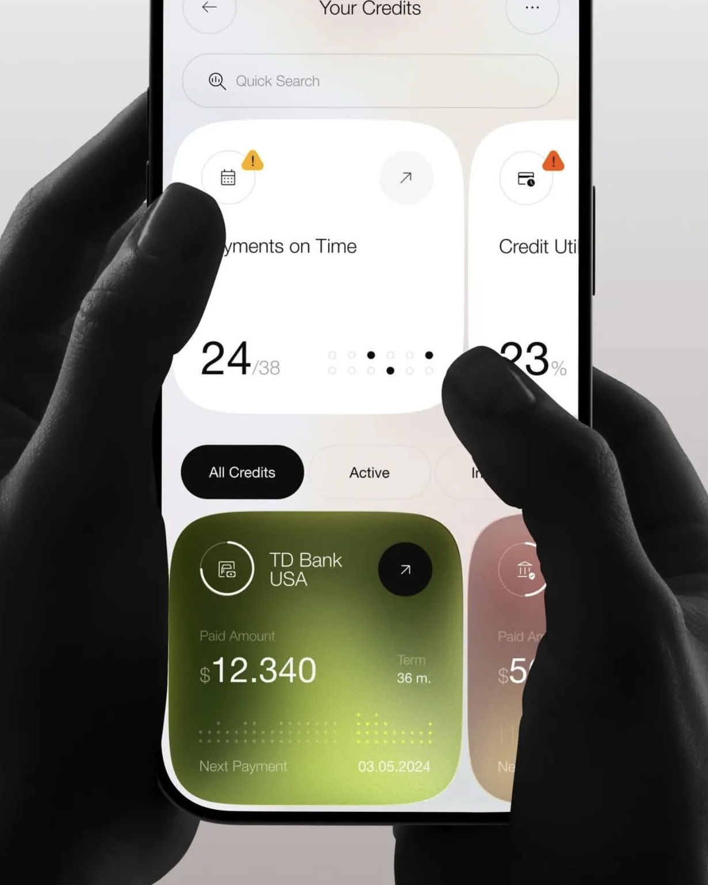
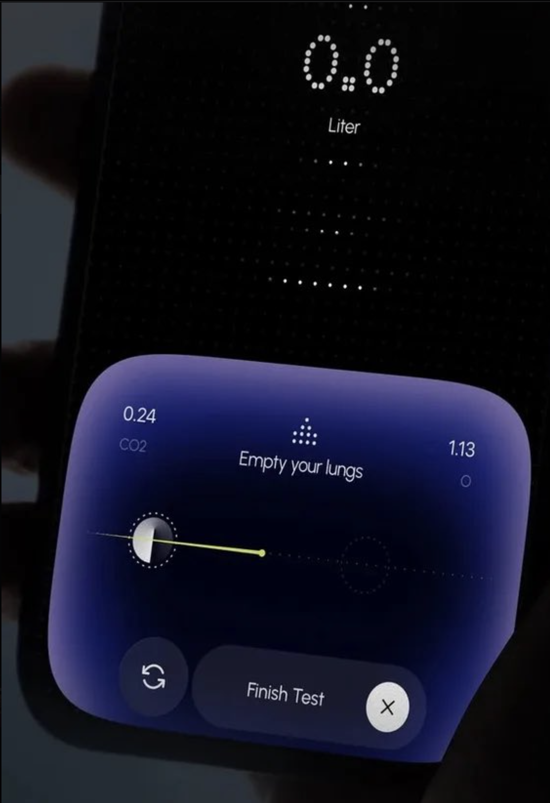
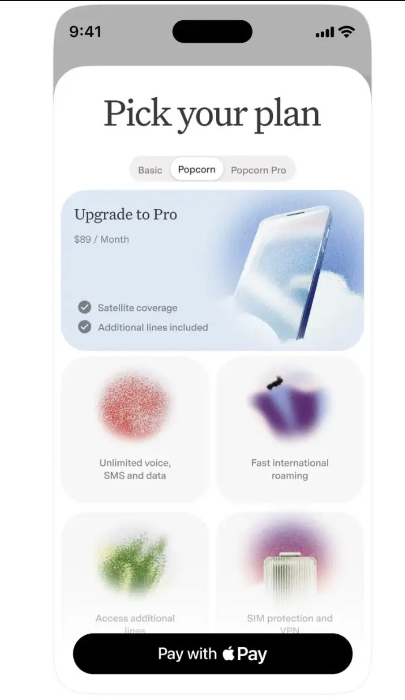

# UI Design Inspiration

A reference-driven design skill for **Codex and Claude**. It teaches a coding agent to inspect a curated visual collection, choose a direction that suits the product, and translate it into working UI.

Built from 13 screenshots and 8 links, with individual source notes, material and motion guidance, and adaptations for web and native apps. The collection reflects Neel Sharma's taste; it is a starting vocabulary you can fork and make your own.

## The visual vocabulary

| Soft utility | Luminous instrument | Airy editorial | Atmospheric workflow |
| --- | --- | --- | --- |
|  |  |  |  |
| Clear metrics, rounded surfaces, restrained contrast | Dark fields, colored edge light, dots and orbs | Spacious composition, expressive imagery, deliberate type | Translucent layers, diagrams, visible process states |

These are third-party design references, not production assets or designs claimed as original work. See the [source index](ui-design-inspiration/references/source-index.md) and [rights and attribution notes](ui-design-inspiration/THIRD_PARTY_NOTICES.md).

## Install locally

Requires Python 3.9+ and Git. No Python packages, API keys, or plugins are required.

```sh
git clone https://github.com/Neel-Sh/ui-design-inspiration.git
cd ui-design-inspiration
python3 scripts/skill.py check
python3 scripts/skill.py install --target both
```

Choose `--target codex` or `--target claude` to install only one. Codex installs under `${CODEX_HOME:-~/.codex}/skills/`; Claude Code installs under `~/.claude/skills/`. The installer refuses to replace an existing copy unless you pass `--replace`. Replacements are backed up outside the skills directory.

Start a new session if the skill is not visible. Normal automatic selection remains enabled; you can also invoke it explicitly:

**Codex**

```text
Use $ui-design-inspiration to build this dashboard. Choose references that fit the product, inspect the images, and preserve the existing features.
```

**Claude Code**

```text
/ui-design-inspiration Refine this app's onboarding using the saved references. Keep native navigation and make the visual direction coherent.
```

You can constrain what to borrow: “Use the plan-picker typography, but keep the colors neutral,” or “Use the dark instrument references for the active session only.”

## Claude chat and Cowork

Download `ui-design-inspiration.zip` from the [latest release](https://github.com/Neel-Sh/ui-design-inspiration/releases/latest), or build it:

```sh
python3 scripts/skill.py package
```

Upload the ZIP in **Customize → Skills** and enable it, following [Anthropic's instructions](https://support.claude.com/en/articles/12512180-use-skills-in-claude). A local Claude Code installation does not upload the skill to your Claude account. Account capabilities and organization settings still apply.

The archive contains one skill folder, its references, license, and third-party notices. It excludes this repository's development tooling and local files. A SHA-256 sidecar is generated alongside it.

## How the skill works

1. Identify the platform, content, primary action, and existing design system.
2. Select a small set of relevant references and open the actual images.
3. Choose hierarchy, typography, spacing, geometry, material, and a signature detail.
4. Implement in the existing stack, with usable narrow layouts and appropriate motion/material fallbacks.
5. Compare rendered results against the selected references when tools permit.

It does not force every effect into every screen, prescribe a framework, or treat screenshots as measured specifications. Video notes come from playback and selected frames, not exhaustive frame analysis. Exact source fonts and easing curves are not claimed. The videos remain linked, and individual linked libraries have not all been tested.

## Update the collection

For updates from this repository:

```sh
git pull --ff-only
python3 scripts/skill.py install --target both --replace
```

For your own inspiration, place new files and URLs in the ignored `inbox/` directory and ask your coding agent:

> Update the UI Design Inspiration skill from the new material in inbox. Inspect it, preserve source attribution, explain what to borrow, update the reference index and manifest, remove capture metadata and URL sharing parameters, run the checks, then refresh my installed copies and package. Do not publish anything unless I ask.

Use [CONTRIBUTING.md](CONTRIBUTING.md) for the reference format and publishing checks. Adding files to an inbox does not update the skill automatically. Installed copies and Claude uploads are snapshots; refresh them after editing.

## Repository checks

```sh
python3 scripts/skill.py check
python3 -m unittest discover -s tests -v
python3 scripts/skill.py package
```

Checks cover reference paths, image hashes/dimensions and capture metadata, canonical links, portable text, common credential patterns, and package contents. CI runs with read-only repository permissions and a commit-pinned checkout action. These checks do not establish ownership of reference artwork or prove design quality.

## License and attribution

The original skill instructions, written analysis, and repository tooling are [MIT licensed](LICENSE). Third-party screenshots, logos, brand names, and linked media retain their respective owners' rights and are **not covered by that license**. Source attribution is recorded where known; missing authorship is explicitly marked rather than guessed. See [THIRD_PARTY_NOTICES.md](ui-design-inspiration/THIRD_PARTY_NOTICES.md).

To report an attribution error or request removal of a reference, [open an issue](https://github.com/Neel-Sh/ui-design-inspiration/issues) with the reference ID and source. Do not include private information in a public issue.
